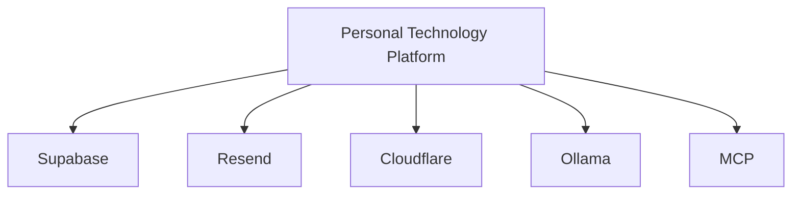
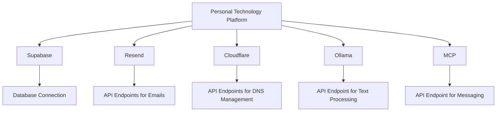

# Integration Architecture Documentation

## Overview
This document outlines the architecture of the integration components for the Personal Technology Platform, focusing on external providers such as Supabase, Resend, Cloudflare, Ollama, and MCP. The architecture is designed to ensure swappability and contract tests for robust and production-ready integration.

## External Providers

### Supabase
**Purpose:** Database service for storing and managing data.
**Integration Points:**
- Database connection
- API endpoints for CRUD operations

### Resend
**Purpose:** Email service for sending emails.
**Integration Points:**
- API endpoint for sending emails
- Configuration for email templates and settings

### Cloudflare
**Purpose:** DNS and web application firewall service.
**Integration Points:**
- API endpoints for DNS management and security settings
- Configuration for DNS records and security policies

### Ollama
**Purpose:** AI service for natural language processing.
**Integration Points:**
- API endpoint for text processing
- Configuration for model selection and settings

### MCP
**Purpose:** Messaging service for real-time communication.
**Integration Points:**
- API endpoint for sending and receiving messages
- Configuration for message routing and delivery

## Swappability and Contract Tests

### Swappability
The architecture is designed to allow for easy swappability of external providers. This is achieved through the use of configuration files and environment variables that define the endpoints and settings for each provider. The configuration files are version-controlled and can be easily swapped out to switch between different providers.

### Contract Tests
Contract tests are used to ensure that the integration points between the Personal Technology Platform and the external providers adhere to the expected behavior and performance. These tests are automated and run as part of the continuous integration process. The tests cover scenarios such as successful and failed API calls, error handling, and performance benchmarks.

## Architecture Diagram

### High-Level Architecture Diagram


### Detailed Architecture Diagram


## Configuration Files

### Supabase Configuration
```yaml
# supabase_config.yml
database_url: "https://your-supabase-instance-url"
database_name: "your-database-name"
database_user: "your-database-user"
database_password: "your-database-password"
```

### Resend Configuration
```yaml
# resend_config.yml
api_key: "your-resend-api-key"
email_template: "your-email-template"
email_settings: "your-email-settings"
```

### Cloudflare Configuration
```yaml
# cloudflare_config.yml
api_key: "your-cloudflare-api-key"
api_secret: "your-cloudflare-api-secret"
dns_records: "your-dns-records"
security_policies: "your-security-policies"
```

### Ollama Configuration
```yaml
# ollama_config.yml
api_key: "your-ollama-api-key"
model_name: "your-model-name"
model_settings: "your-model-settings"
```

### MCP Configuration
```yaml
# mcp_config.yml
api_key: "your-mcp-api-key"
message_routing: "your-message-routing"
message_delivery: "your-message-delivery"
```

## Conclusion
The architecture for the integration of the Personal Technology Platform with external providers such as Supabase, Resend, Cloudflare, Ollama, and MCP is designed to be flexible and robust. The swappability and contract tests ensure that the integration points are reliable and performant. The detailed documentation and configuration files provide a clear and comprehensive guide for setting up and managing the integration architecture.

## References
- [Supabase Documentation](https://supabase.com/docs)
- [Resend Documentation](https://resend.com/docs)
- [Cloudflare Documentation](https://www.cloudflare.com/docs)
- [Ollama Documentation](https://ollama.ai/docs)
- [MCP Documentation](https://messaging.cloudplatform.com/docs)
