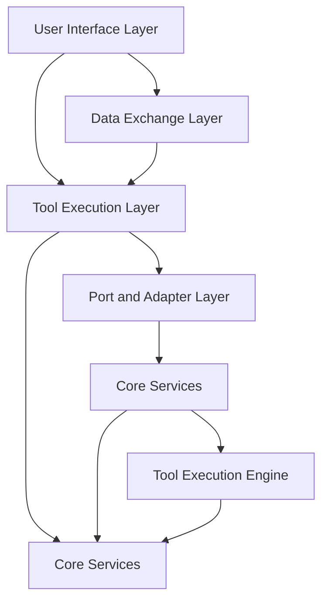
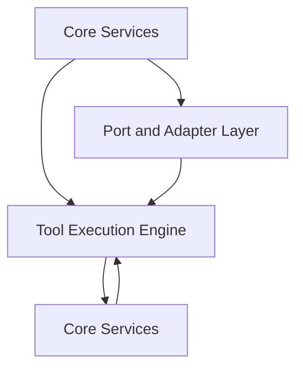

# docs/architecture/system-architecture.md

## Overview
This document details the system architecture of the Personal Technology Platform, which is designed as a modular monolith with a focus on the use of ports and adapters, and a tool execution engine. The architecture is designed to be modular, allowing for easy extension and maintenance. It includes boundary layers to define the system's external interfaces and dependency rules to ensure the system's integrity and stability.

## Architecture Overview
The Personal Technology Platform is built as a monolithic application, which means all components are integrated into a single, cohesive system. This approach simplifies deployment and management but requires careful design to ensure scalability and maintainability.

### Components
The platform consists of several key components:
- **Core Services**: These are the core functionalities of the platform, such as user management, data storage, and application logic.
- **Port and Adapter Layer**: This layer acts as a bridge between the core services and the external systems. It includes the boundary layers and dependency rules.
- **Tool Execution Engine**: This component is responsible for executing various tools and scripts, which are used to extend the platform's functionality.

## Boundary Layers
Boundary layers define the external interfaces of the system. They specify the protocols and formats used for communication with external systems and applications. The boundary layers are crucial for ensuring that the system remains isolated from external dependencies and can be easily integrated with other systems.

### External Interfaces
The Personal Technology Platform communicates with external systems through the following boundary layers:
- **User Interface Layer**: Handles user interactions and provides a user-friendly interface for the platform.
- **Data Exchange Layer**: Manages the exchange of data with external systems, such as databases and APIs.
- **Tool Execution Layer**: Interfaces with external tools and scripts for execution.

## Dependency Rules
Dependency rules are defined to ensure that the system's components are properly isolated and that the system remains stable and secure. These rules specify the dependencies between components and define how they interact with each other.

### Dependency Rules
The Personal Technology Platform enforces the following dependency rules:
- **Core Services Dependency**: The core services depend on the port and adapter layer for communication with external systems.
- **Port and Adapter Layer Dependency**: The port and adapter layer depends on the core services for functionality and the tool execution engine for execution.
- **Tool Execution Engine Dependency**: The tool execution engine depends on the core services for data and the port and adapter layer for communication.

## Mermaid Diagrams
### Boundary Layers

### Dependency Rules

## Detailed Architecture
### Core Services
The core services are the foundation of the Personal Technology Platform. They provide the essential functionalities such as user management, data storage, and application logic. The core services are designed to be loosely coupled with the port and adapter layer, allowing for easy integration with external systems.

### Port and Adapter Layer
The port and adapter layer acts as a bridge between the core services and the external systems. It includes the boundary layers and dependency rules to ensure that the system remains isolated and secure. The port and adapter layer is designed to be modular, allowing for easy extension and maintenance.

### Tool Execution Engine
The tool execution engine is responsible for executing various tools and scripts. These tools and scripts are used to extend the platform's functionality and provide additional features. The tool execution engine is designed to be loosely coupled with the core services and the port and adapter layer, allowing for easy integration with external systems.

## Conclusion
The Personal Technology Platform is designed as a modular monolith with a focus on the use of ports and adapters, and a tool execution engine. The architecture is designed to be modular, allowing for easy extension and maintenance. It includes boundary layers to define the system's external interfaces and dependency rules to ensure the system's integrity and stability.
